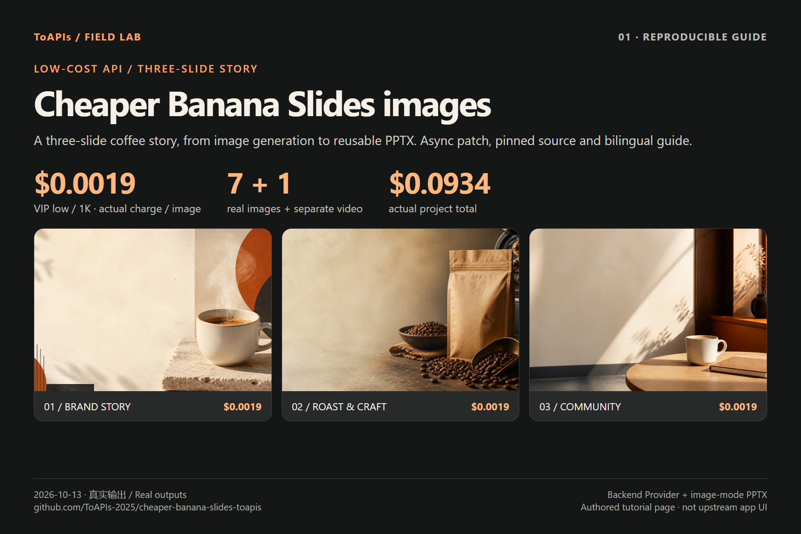

# Video and PPTX demo

[English](DEMO.md) · [中文](DEMO_zh-CN.md)

## Real image-to-video clip

[MP4 viewer](https://github.com/ToAPIs-2025/cheaper-banana-slides-toapis/blob/main/assets/coffee-motion.mp4) · [Original MP4](https://raw.githubusercontent.com/ToAPIs-2025/cheaper-banana-slides-toapis/main/assets/coffee-motion.mp4)

Input: [the real generated first frame](assets/vip-low-01.png). Separate extension: upload → grok-video-1.5 / first_frame_image_to_video / 4s / 480p / 16:9 → poll task → download MP4. Actual output: 736×400, 4.04 seconds. Dashboard charge: 8.16 credits=$0.0408. [Request and task evidence](evidence/video-extension.json).

The GIF samples the original clip every 0.1 seconds for a homepage preview. The original MP4 is unchanged. This is a generated-output demo, not a recorded application walkthrough. Native upstream video support and audio remain untested.

## Three-slide PPTX reuse

[Standard PPTX](assets/standard-three-slides.pptx) · [VIP-low PPTX](assets/vip-low-three-slides.pptx) · [Editable-caption copy](assets/vip-low-native-captions.pptx)

The two original PPTX files use image-mode export. Only captions added by the independent helper are editable; full OCR editable export is untested. Reproduction commands are in [the guide](README.md).
